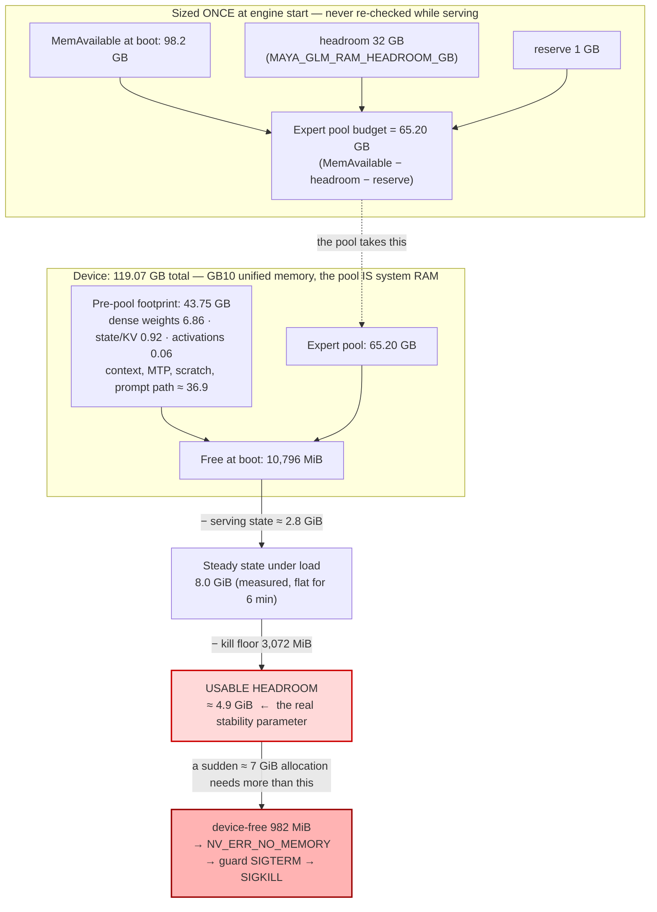
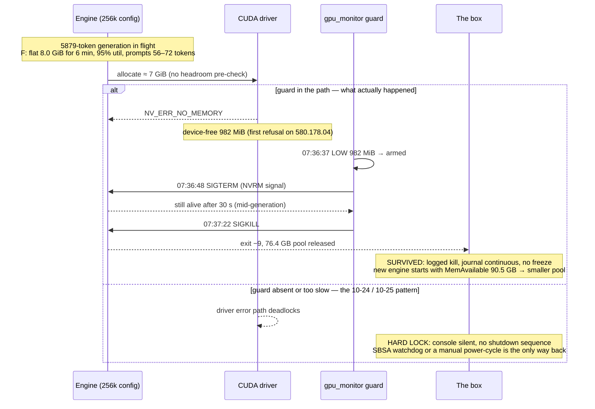
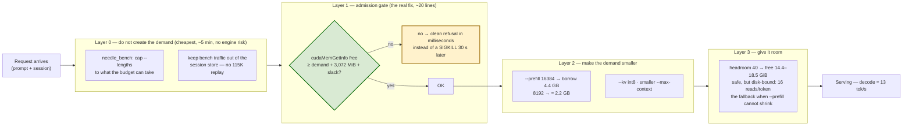

# Why the 256K config dies: the budget, the breach, and the four ways to stop it

Date: 2026-10-26
Status: diagrams for the two memory kills of 2026-10-25/26 (20:42 and 07:36) and the
prevention layers. Companion to `docs/STABILITY-1.md` (the headroom/chunk parameters,
now fully measured, incl. the 115K prompt at 32/36/40) and
`docs/2026-10-25-driver-580-residual-kernels.md` (the unrelated kernel residual).
Affects: `maya-maya-s-v2-iq2_xxs-256k.json`, `src/core/glm_fast_path.cu` (pool sizing),
`src/core/glm_prefill.cu` (chunk borrow), `tools/needle_bench.py` (where the big prompts
come from).

## The problem in one paragraph

A GB10 has no VRAM: the CUDA pool *is* system RAM, and `MemAvailable` cannot see the
driver's pages. The expert pool is sized **once at engine start** from
`MemAvailable − headroom − 1 GB`, and the prompt path's own borrow is printed at boot but
never reserved. What is left after the pool is the only thing that can absorb a large
allocation, and on the 256k config that number has been **≈ 5 GiB usable above the
3,072 MiB kill floor**. A single ≈ 7 GiB allocation during serving is therefore enough to
breach it — which is what happened at 07:36, with a 56-token prompt in flight. The guard
turns that breach into a logged SIGKILL; without the guard the driver's own error path
deadlocks and the box hard-locks.

---

## 1. Where the memory goes (and what is actually left)



The two numbers that decide everything: **free-at-boot** (set by headroom) and **the
largest single allocation the engine will attempt** (set by chunk size, KV growth and
session state). Everything else is fixed cost.

---

## 2. What happened at 07:36 (and what the guard prevented)



The guard is the only thing between a memory breach and a hard lock. It has now caught
every breach on this box — but catching them is not the same as not having them.

---

## 3. The two events, side by side

| | 2026-10-25 20:42 | 2026-10-26 07:36 |
|---|---|---|
| Config | headroom 32, `--prefill auto` (32768) | headroom 32, `--prefill 16384` |
| Prompt borrow | 6,775 MB | 4,417 MB |
| Free at boot | 6.3–6.6 GiB | 10,796 MiB |
| Trigger | 115,201-token prompt prefill | ≈ 7 GiB allocation mid-generation (5879-token request) |
| device-free floor hit | 2.50 GiB | **982 MiB** + `NV_ERR_NO_MEMORY` |
| Guard outcome | SIGTERM → SIGKILL | SIGTERM → SIGKILL |
| Box | survived | survived |

Reducing the chunk size moved the failure from "prompt-driven" to "allocation-driven" and
made the breach *deeper* (982 MiB vs 2.5 GiB), because the baseline it breached from was
higher. The chunk knob buys margin; it does not remove the failure mode.

---

## 4. The four prevention layers



| Layer | Stops 20:42? | Stops 07:36? | Cost |
|---|---|---|---|
| 0 — bench cap + no session replay | yes (removes the source) | partially (removes the replayed 115K state) | none; loses the long-context bench |
| 1 — admission gate on **every** large allocation | yes | **yes** | ~20 lines in `generate.cpp`, following the refusal idiom already at `glm_fast_path.cu:1178` |
| 2 — smaller prefill chunks | yes | no (this was not a prefill) | some prefill throughput |
| 3 — headroom 40 | yes | yes, with margin | **disk-bound decode** (16 reads/token vs 4.7) — the fallback when the chunk cannot shrink, not a cheap option |

Layer 1 is the only one that is source-agnostic: it does not care whether the demand comes
from a needle bench, a pasted document, a replayed session or an in-generation allocation
the engine makes on its own behalf. Layers 0 and 2 reduce how often it has to say no;
Layer 3 raises how much it can say yes to.

## Where the 115K prompt stands now

The shipped config (**headroom 32 + `--prefill 16384`**) has been measured against a real
115K-token prefill, and it holds:

| config | pool budget | free at boot | measured dip during the 115K prefill | vs 3,072 MiB floor |
|---|---|---|---|---|
| 32 + `auto` (32768) | 65.2 GB | 7.6 GiB | **2.5 GiB** | −0.6 GiB → **killed at 20:42** |
| **32 + `16384` (shipped)** | 65.4 GB | 10.5 GiB | **9.8 GiB** | **+6.7 GiB → safe**, 13.4 tok/s, 4.7 reads/token |
| 32 + `8192` | 65.4 GB | 10.5 GiB | 9.7 GiB | +6.6 GiB → safe, +12 % prefill time |
| 36 + `auto` | 61.2 GB | 10.3 GiB | ~8.1 GiB | +5.1 GiB → safe, disk-bound (16.8 reads/token) |
| 40 + `auto` | 57.1 GB | 14.4–18.5 GiB | ~16.1 GiB | +13 GiB → safe, disk-bound (16.0 reads/token) |

So the 115K prompt is **no longer the failure mode** — Layer 2 already closed it, and the
full run is in `REGRESSION.md`. What remains open is the 07:36 class: a ≈ 7 GiB allocation
the engine makes on its own behalf during serving, against a steady-state `F:` of ~8 GiB.
No chunk size or headroom value is measured against that case, which is why Layer 1 is the
one that still has to be built.

**The rule the gate enforces**, and the number to watch:

```
cudaMemGetInfo free  ≥  next allocation estimate  +  3,072 MiB  +  ~1 GiB slack
```

`maya serve: CUDA0: N MiB of VRAM free with everything loaded` is the boot-time value;
the steady-state value is what the monitor's `F:` field reports under load.

---

## 5. Cross-references

- `docs/STABILITY-1.md` — the headroom and prefill-chunk parameters, the fully measured
  table (incl. the 115K prompt at 32/36/40), and how to re-measure after any change.
- `REGRESSION.md` — the run behind those measurements.
- `.opencode/skills/dgx-spark-memory-forensics` — reading `F:` / `N:` / `A:`, the
  3,072 MiB floor, and why `NV_ERR_NO_MEMORY` is a warning shot rather than a recoverable
  error.
- `.opencode/skills/gb10-hardlock-triage` §5 — the expert-pool footprint hypothesis these
  two events refine: it is not the pool *size*, it is the **unusable remainder** above the
  floor.
- `docs/MEMORY_WATCHDOGS_DEEP_DIVE.md` — the guard that converts a breach into a logged
  kill instead of a power-cycle.
